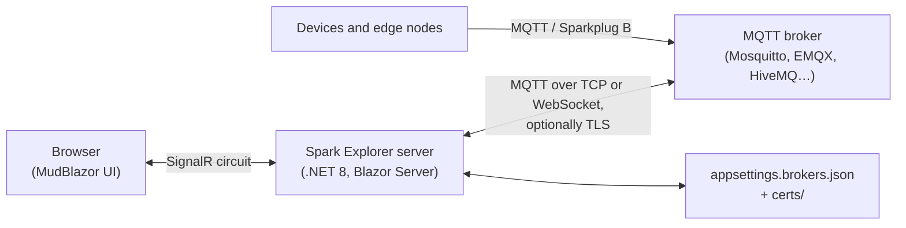
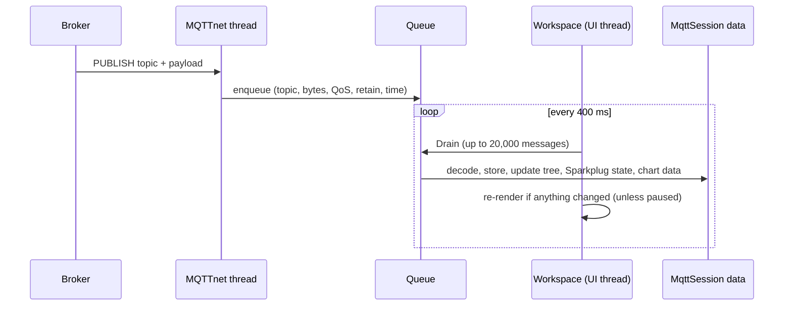
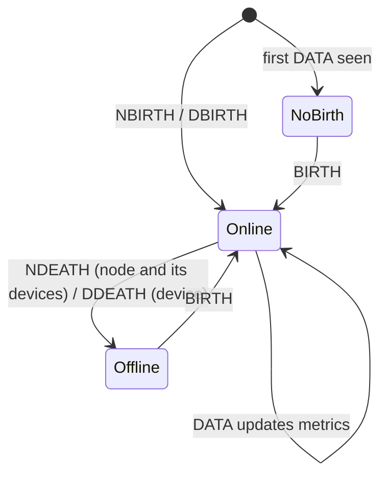

# How Spark Explorer works

Spark Explorer is a web application for watching and working with an MQTT broker. It shows every message on a live
topic tree, decodes **Sparkplug B** payloads into readable metrics, keeps track of Sparkplug edge nodes and devices,
charts numeric values over time, and lets you publish messages and send Sparkplug commands.

This document explains what the app does, how each part works internally, and how to configure and run it.

---

## Contents

1. [The big picture](#1-the-big-picture)
2. [The screen](#2-the-screen)
3. [Brokers and connections](#3-brokers-and-connections)
4. [TLS](#4-tls)
5. [From network to screen: the message pipeline](#5-from-network-to-screen-the-message-pipeline)
6. [The topic tree](#6-the-topic-tree)
7. [The topic view and payload formats](#7-the-topic-view-and-payload-formats)
8. [Sparkplug B](#8-sparkplug-b)
9. [Charts](#9-charts)
10. [Publishing and commands](#10-publishing-and-commands)
11. [Demo mode](#11-demo-mode)
12. [Configuration reference](#12-configuration-reference)
13. [Running the app](#13-running-the-app)
14. [Limits and memory use](#14-limits-and-memory-use)
15. [Security notes](#15-security-notes)
16. [Troubleshooting](#16-troubleshooting)
17. [Source code map](#17-source-code-map)

---

## 1. The big picture

Spark Explorer is a **Blazor Server** application built on .NET 8. The user interface uses the **MudBlazor** component
library, and the MQTT connection is made with **MQTTnet**.

In a Blazor Server app, the page in your browser is a thin view: the application logic runs on the server, and the
browser and server stay connected through a SignalR WebSocket (called a *circuit*). This has one important consequence:
**the connection to the MQTT broker is made by the server, not by the browser.** That is why the app can connect over
plain TCP (port 1883/8883), which browsers cannot do on their own, as well as over WebSocket.



Two server-side services do most of the work:

| Service | Lifetime | What it holds |
|---|---|---|
| `MqttSession` | **One per browser tab** (scoped to the Blazor circuit) | The MQTT connection, all received messages, the topic tree, Sparkplug state and chart data for that tab |
| `BrokerStore` | **One for the whole app** (singleton) | The saved broker list, read from and written to `appsettings.brokers.json`, plus uploaded certificate files |

Because each tab has its own `MqttSession`, two tabs can be connected to different brokers at the same time, and
closing a tab disconnects its session. Saved brokers, on the other hand, are shared: a broker added in one tab
appears in the broker list of every other open tab.

---

## 2. The screen

```
┌──────────────────────────────────────────────────────────────────────────────┐
│ App bar:  Spark Explorer        [status chip]   [Start demo]   [dark mode]   │
├──────────────────────────────────────────────────────────────────────────────┤
│ Broker bar: [Broker ▼]  mqtts://host:8883 [TLS] [user]   [Connect] [⚙] [+]   │
├──────────────────────────┬───────────────────────────────────────────────────┤
│ [Filter topics] [⏸] [🗑] │  Topic │ Sparkplug nodes │ Publish                │
│                          │                                                   │
│ Topic tree               │  Tab content                                      │
│  ▾ factory               │                                                   │
│     ▾ line1              │                                                   │
│        status  {...}     ├───────────────────────────────────────────────────┤
│        temperature 22.9  │  Chart panel (only when data points are selected) │
│  ▸ spBv1.0               │                                                   │
├──────────────────────────┴───────────────────────────────────────────────────┤
│ Status bar: Topics · Messages · Rate/s · Sparkplug edge nodes · Data points  │
└──────────────────────────────────────────────────────────────────────────────┘
```

- **App bar.** The status chip shows the connection state: grey when disconnected, amber while connecting or
  reconnecting, green when connected, red on an error. Hover over it to read the full message. **Start demo** generates
  simulated traffic. The sun/moon button switches between light and dark themes; on first load the app follows your
  operating system's setting.
- **Broker bar.** Choose a saved broker, see its address and whether it uses TLS or a login, and connect or disconnect.
  The gear button edits the selected broker; the **+** button adds a new one. These controls are disabled while
  connected, so settings can't change under an active connection.
- **Left side.** The live topic tree, with a filter box, a **pause** button (stops refreshing the view while messages
  keep being recorded), and a **clear** button (forgets everything received so far).
- **Right side.** Three tabs: **Topic** (details of the selected topic), **Sparkplug nodes** (an overview of all
  Sparkplug edge nodes and devices) and **Publish**. Below the tabs, the **chart panel** appears as soon as you select
  a data point to plot.
- **Status bar.** Counts of topics, messages, message rate per second, Sparkplug edge nodes and recorded data points.
  It also warns when messages had to be dropped, and when the view is paused.

### Why the screen doesn't flicker

The data on screen is refreshed a few times per second. To keep this cheap and steady, the page is split in two
components:

- `Home` contains the app bar, the broker bar, and the theme, dialog, popover and notification providers.
  It only re-renders when you interact with it or the connection status changes.
- `Workspace` contains everything that shows live data (tree, tabs, chart, status bar) and runs its own refresh loop.

This keeps tooltips, drop-down menus and dialogs in the top part of the screen from being redrawn while you use them.

---

## 3. Brokers and connections

### Broker profiles

A *broker* in Spark Explorer is a named profile with all the settings needed to connect:

| Group | Settings |
|---|---|
| Connection | Name, transport (TCP or WebSocket), host and port (TCP) or URL (WebSocket), MQTT version (3.1.1 or 5.0), client ID |
| Login | Username, password, and whether passwords are saved |
| TLS | On/off and the TLS settings described in [section 4](#4-tls) |
| Subscriptions | Comma-separated topic filters (for example `#, $SYS/#, spBv1.0/#`) and the subscription QoS |

An empty client ID makes the app generate one (`spark-explorer-` plus six random characters) for each connection.

### Where brokers are saved

Brokers are stored in **`appsettings.brokers.json`**. By default this file sits next to `appsettings.json`;
the setting `BrokerStore:Path` (environment variable `BrokerStore__Path`) moves it, for example onto a Docker volume.
Relative paths are relative to the application's folder.

The file looks like this:

```json
{
  "Brokers": [
    {
      "Id": "abf810857861",
      "Name": "Plant broker",
      "Transport": "Tcp",
      "Host": "broker.plant.local",
      "Port": 8883,
      "WebSocketUri": "ws://localhost:9001",
      "UseTls": true,
      "Tls": {
        "AllowUntrustedCertificates": false,
        "CheckRevocation": false,
        "CaCertificatePath": "certs/plant-ca.crt",
        "ClientCertificatePath": "certs/client.pfx",
        "Version": "Auto"
      },
      "ClientId": "",
      "Username": "operator",
      "SavePasswords": false,
      "ProtocolVersion": 4,
      "Subscriptions": "#, spBv1.0/#",
      "SubscribeQos": 0
    }
  ]
}
```

How the file is managed:

- **First start.** If the file doesn't exist, it is created immediately from `appsettings.json`. If that file has a
  `Brokers` array, all its entries are used; otherwise one broker is made from the `Mqtt` section. Environment variables
  such as `Mqtt__Host` therefore only affect the *first* broker, before the file exists.
- **Saving.** The whole list is written to a temporary file which then replaces the real file, so a crash mid-write
  can't leave a half-written settings file.
- **Sharing.** All browser tabs share the same list. When one tab saves or deletes a broker, other tabs update their
  broker list straight away.
- **Repairs on load.** Missing or duplicate IDs are replaced, and a broker without a name gets its address as its name.
- **Errors.** If the file can't be read or created, the app shows a notification and logs the problem. The path in use
  is written to the log at startup (`Saved brokers: …`).

### Passwords

Passwords (the login password and the client-certificate password) are written to the file **only** when
**Save passwords in the settings file** is ticked, and then as plain text. When it isn't ticked, a password you type
is kept in memory for the current browser tab only. After a restart or in a new tab you enter it again; if you forget,
the connection error says that the password isn't saved and where to enter it.

### Connecting

When you press **Connect**, the session:

1. Disconnects any existing connection and takes a copy of the selected broker's settings.
2. Builds the MQTTnet client options: client ID, clean session, 30-second keep-alive, 10-second operation timeout,
   MQTT version, TCP host/port or WebSocket URL, TLS options and credentials.
3. Connects, waiting at most 15 seconds.
4. Once connected, subscribes to every topic filter in the broker's subscription list with the chosen QoS. If the broker
   refuses a filter (for example because of access rules), the status says which ones.

The status chip follows every step: *Connecting to …*, *Connected to …*, or *Connect failed: …* with the reason.

### Reconnecting

If an established connection drops, the session switches to *Reconnecting* and tries again every **3 seconds** until it
succeeds or you press Disconnect. After reconnecting it subscribes again, because connections use a clean session.
A connection that fails on the *first* attempt is not retried automatically; the error is shown instead, so you can fix
the settings.

---

## 4. TLS

TLS is switched on per broker. For TCP the port changes from 1883 to 8883 when you switch TLS on (and back when you
switch it off); for WebSocket the URL changes between `ws://` and `wss://`.

### Settings

| Setting | Purpose |
|---|---|
| **CA certificate** | A CA certificate (PEM, CRT or DER) to trust in addition to the operating system's trusted roots. Needed for brokers whose certificate comes from a private or self-signed CA. |
| **Client certificate** | For brokers that require clients to present a certificate (mutual TLS). A PFX/P12 file, or a PEM certificate. |
| **Client key** | The private key in PEM format, when it is in a separate file from the PEM certificate. |
| **Certificate password** | The password of a PFX file or an encrypted PEM key. |
| **Server name** | The host name to expect in the broker's certificate (also sent as SNI) when you connect using an IP address or a different name. TCP only; for WebSocket, put that name in the URL. |
| **TLS version** | Auto (TLS 1.2 or 1.3), TLS 1.2 only, or TLS 1.3 only. |
| **Check certificate revocation** | Off by default, because private CAs often have no reachable revocation list. |
| **Accept any server certificate** | Skips all certificate checks. Insecure; use it only for testing. |

### Certificate files and uploads

Certificate paths can be absolute, or relative to the folder of the settings file. The **Upload** buttons in the broker
dialog copy a file (up to 1 MB; `.pem .crt .cer .der .key .pfx .p12`) from your computer into a `certs` folder next to the
settings file and fill in the relative path, such as `certs/ca.crt`. If a file with that name already exists, a number is
added (`ca-2.crt`) instead of overwriting it.

Loading rules:

- **CA certificates.** PEM files may contain several certificates, and all of them are trusted. Other files are read as
  a single DER certificate.
- **PFX/P12 client certificates.** Read with the certificate password.
- **PEM client certificates.** The key is read from the separate key file, or from the certificate file itself when no
  key file is given. An encrypted key uses the certificate password. The certificate is then converted internally to
  PKCS#12, because Windows' TLS implementation can't use the temporary key of a PEM-loaded certificate.
- Missing files, wrong passwords and certificates without a private key produce a clear error before connecting.

### How the broker's certificate is checked

MQTTnet only applies a custom CA on TCP connections, so Spark Explorer checks the broker's certificate itself. That way
the rules are identical for TCP and WebSocket:

1. If **Accept any server certificate** is on, the certificate is accepted.
2. If the operating system already trusts the certificate and the name matches, it is accepted.
3. If the broker sent no certificate, the connection is refused.
4. If the certificate is for a **different host name**, the connection is refused. The message names the host the
   certificate was issued to, and suggests connecting with that name or setting **Server name**.
5. Otherwise the certificate chain is built again with the configured **CA certificate** as the trusted root (plus any
   intermediate certificates the broker sent), with revocation checking on or off as configured. If that chain is valid,
   the certificate is accepted.
6. If not, the connection is refused and the status lists the reasons from the chain check (for example
   *self-signed certificate in certificate chain*) and what to do about it.

A broker that requires a client certificate usually just closes the connection when none is sent, without saying why.
When that happens and no client certificate is configured, the error message adds a hint to add one.

---

## 5. From network to screen: the message pipeline

Messages arrive on MQTTnet's network threads, while Blazor renders on its own synchronization context. To avoid any
race between the two, the app never changes its data on a network thread:



1. **Receive.** The MQTTnet callback only copies the message into a thread-safe queue, with the time it was received.
   If the queue already holds 200,000 messages, new messages are dropped and counted (the status bar shows the count).
2. **Drain.** Every 400 ms the `Workspace` component asks the session to process the queue on the UI thread, at most
   20,000 messages per tick.
3. **Process.** For each message the session:
   - decodes it as Sparkplug B when the topic is in the Sparkplug namespace, and updates the node and device state;
   - records Sparkplug `STATE` messages from host applications;
   - extracts numeric values for charts;
   - adds it to the topic's history (newest first, the last 100 messages);
   - updates the message and topic counters along the topic's path in the tree.
4. **Render.** If anything changed, the workspace re-renders. While the view is paused, processing continues but
   nothing is redrawn; you see the current state again when you resume.

The message rate in the status bar is the number of messages processed per second, recalculated every second.

---

## 6. The topic tree

The tree is built from topic levels: `factory/line1/temperature` becomes `factory › line1 › temperature`. A topic can be
both a message topic and a branch (for example `a` and `a/b`). Empty levels, such as the first level of `/sensor`, are
shown as *(empty)*.

- **Rows.** Each row shows the level name, the latest value of that topic (shortened to 90 characters), and a count:
  for branches the number of topics and messages below it, for leaves the number of messages.
- **Sparkplug previews.** Sparkplug topics show the message type and metric count, such as `DDATA – 3 metrics`, in blue.
- **Change highlight.** When a value changes, its preview briefly lights up. This is done by switching between two
  identical CSS animations, which makes the browser replay the effect. Users who prefer reduced motion don't get the
  animation.
- **Sorting.** Levels are sorted "naturally", so `sensor2` comes before `sensor10`, ignoring upper and lower case.
- **Expanding.** Click the arrow to expand or collapse a branch. Clicking a topic selects it and opens the Topic tab;
  clicking an already-selected topic that also has children expands or collapses it.
- **Filter.** The filter box shows only topics whose full path contains the text (not case-sensitive), with all their
  parent levels expanded.
- **Performance.** Only the rows visible on screen are actually drawn (Blazor `Virtualize`), and the tree shows at most
  20,000 rows.

---

## 7. The topic view and payload formats

Selecting a topic shows:

- **Header.** The full topic, number of messages, receive time, QoS, retained flag and payload size.
- **Toolbar.** A **View** selector, **Copy topic**, **Copy payload**, **Clear retained** (only when connected) and
  **Show latest** (when looking at an older message).
- **The payload**, in the chosen format.
- **History.** The last 100 messages; click one to inspect it. While an older message is shown, the view stays on it
  until you press **Show latest**.

### How payloads are recognised

With **View: Auto**, the format is chosen like this:

1. Topics in the Sparkplug namespace (`spBv1.0/<group>/<type>/<edge node>[/<device>]`) are shown as **Sparkplug**.
2. Otherwise the bytes are decoded as UTF-8. If that fails, or the text contains control characters other than tab,
   carriage return and line feed, the payload is treated as **binary** and shown as a hex dump.
3. Text that starts like JSON (`{`, `[`, `"`, a digit, `-`, `true`, `false` or `null`) and parses as JSON is shown as
   **JSON**: indented and colour-coded (keys, strings, numbers and literals in different colours).
4. Anything else is shown as plain **text**. An empty payload is shown as *(empty payload)*.

You can force any format: **Sparkplug** decodes any payload as Sparkplug B (useful for other namespaces), **JSON**,
**Text**, or **Hex**. The hex dump shows offset, bytes and ASCII, up to 8 KB.

**Copy payload** copies the decoded Sparkplug payload as JSON, a hex dump for binary data, or the text itself.
**Clear retained** asks for confirmation, then publishes an empty retained message to the topic, which removes the
retained message from the broker.

### Data points in JSON payloads

For JSON and plain-number payloads, a **Data points** bar lists every numeric value found, as chips such as
`oee = 0.79`. Click a chip to chart it. The JSON is searched up to 5 levels deep, at most 16 items per array and 64
values in total; booleans count as 0 and 1. Paths use dots and indexes, for example `machine.axes[2].load`. A payload
that is just a number appears as `value`.

---

## 8. Sparkplug B

[Sparkplug B](https://sparkplug.eclipse.org/) defines how industrial devices use MQTT: a fixed topic structure, a protobuf
payload format, birth and death certificates, and aliases.

### Topics

| Topic | Meaning |
|---|---|
| `spBv1.0/<group>/NBIRTH/<edge node>` | Edge node came online; lists all its metrics with names, aliases and types |
| `spBv1.0/<group>/NDATA/<edge node>` | Changed edge-node metric values |
| `spBv1.0/<group>/NDEATH/<edge node>` | Edge node went offline (usually the MQTT "last will") |
| `spBv1.0/<group>/NCMD/<edge node>` | Command to an edge node |
| `spBv1.0/<group>/DBIRTH/<edge node>/<device>` | Device came online, with its metrics |
| `spBv1.0/<group>/DDATA/<edge node>/<device>` | Changed device metric values |
| `spBv1.0/<group>/DDEATH/<edge node>/<device>` | Device went offline |
| `spBv1.0/<group>/DCMD/<edge node>/<device>` | Command to a device |
| `spBv1.0/STATE/<host id>` | Host application status (Sparkplug 3: JSON with `"online": true/false`) |
| `STATE/<host id>` | Host application status (Sparkplug 2: text `ONLINE` / `OFFLINE`) |

### Decoding

Payloads are decoded by a small built-in protobuf reader (`ProtoReader`) that follows the official Eclipse Tahu
`sparkplug_b.proto` schema; no generated code or extra library is needed. It reads the payload timestamp, sequence number,
UUID, body and all metrics, including metadata, properties (also nested property sets), DataSets and Templates. Unknown
fields are skipped, so payloads from newer schema versions still decode. A payload that isn't valid protobuf produces a
readable error instead of crashing.

The same module can also encode payloads (`ProtoWriter`), which the app uses for Rebirth commands and demo traffic.

### Aliases

To save bandwidth, edge nodes usually send a metric's name and datatype only in the birth certificate; DATA messages then
carry just a numeric **alias**. Spark Explorer remembers these per edge node:

- An **NBIRTH** starts a fresh alias table for that edge node.
- Every **NBIRTH and DBIRTH** adds its metrics' alias → (name, datatype) pairs to the edge node's table. Aliases are
  unique across an edge node and its devices, as the specification requires.
- When a DATA metric has only an alias, the name and datatype are filled in from the table. The metric table then marks
  it *name from birth alias*. A metric with a name but no datatype gets its datatype from the birth certificate too.
- If the app connected *after* a node's birth, it can't know the names yet, so metrics appear as *unknown alias*. Use the
  **Rebirth** button (see [section 10](#10-publishing-and-commands)) to make the node send its births again.

Knowing the datatype matters because Sparkplug sends small signed integers in unsigned protobuf fields. For example, an
Int8 value of −3 arrives as 4294967293 and is only shown as −3 when its type is known.

### Datatypes

| Sparkplug type | How it is shown |
|---|---|
| Int8, Int16, Int32, Int64 | Signed number (two's complement converted back) |
| UInt8, UInt16, UInt32, UInt64 | Unsigned number |
| Float, Double | Number (Float with 7 significant digits) |
| Boolean | `true` in green, `false` in red |
| String, Text, UUID | Quoted text |
| DateTime | Local date and time with milliseconds, plus the raw Unix milliseconds |
| Int8Array … DoubleArray, DateTimeArray | List of values, decoded little-endian from the bytes field (first 40 shown) |
| BooleanArray | List of booleans (4-byte count followed by bits, most significant bit first) |
| StringArray | List of strings (null-separated) |
| Bytes, File, unknown | Hex bytes |
| DataSet | A small table with column names and types (first 100 rows) |
| Template | Expandable list of the template's parameters and member metrics |
| PropertySet / PropertySetList | `key=value` pairs |

Each metric row also shows the alias, type and timestamp, flags for *historical* and *transient* metrics, properties
such as `engUnit="°C"`, and the metadata description if present. **Show decoded payload as JSON** displays the whole
decoded payload.

### The Sparkplug nodes tab

Besides showing individual messages, the app keeps a live model of every edge node and device it has seen:



- **Status.** A birth marks the node or device **online** and replaces its metric list. A DDEATH marks the device
  **offline**; an NDEATH marks the edge node *and all its devices* offline. Nodes seen only through DATA messages show
  **no birth**.
- **Layout.** Nodes are grouped by Sparkplug group. Each edge node card shows its status, number of devices and metrics,
  last sequence number, last message type and how long ago it arrived. Below it are its metrics, then each device with
  its own status and metrics.
- **Metric values.** Every metric's latest value, type and timestamp, updated by births and DATA messages. Cards and
  devices can be collapsed.
- **Host applications.** Their online/offline state from `STATE` messages is listed at the top.
- **Rebirth.** Each edge node card has a **Rebirth** button (see below).

---

## 9. Charts

### What is recorded

Every numeric value is recorded as it arrives, whether or not it is being charted. That way, when you select a data
point, its recent history is already there. A *data point* is:

- a Sparkplug metric of a particular edge node or device (from births and DATA messages);
- a topic whose payload is a plain number;
- a numeric field inside a JSON payload.

Booleans are recorded as 0 and 1. Each data point keeps its last **2,000 values**. Sparkplug metrics are recorded with
their own timestamp (or the payload's), so historical and late values are inserted in the right place in time. Other
values use the time they were received. At most 10,000 data points are tracked; after that, new ones are only recorded
once you select them.

### Selecting data points

Click the chart button next to a value, or click the row itself, in any of these places:

- the metric table of a Sparkplug message in the **Topic** tab;
- the metric tables in the **Sparkplug nodes** tab;
- the **Data points** chips of a JSON or numeric topic.

Click again to remove it. Selected rows are highlighted, and the selection is shared by all three places.

### The chart panel

The chart panel opens below the tabs as soon as one data point is selected. It shows a live line chart of all selected
data points, each in its own colour, with a chip per data point (click × to remove it). Above the chart:

- **Time window.** 1 minute, 5 minutes, 15 minutes, 1 hour, or everything kept.
- **Normalize.** Scales each line to its own range (0–100 %), so values with very different ranges, like a temperature
  of 41 °C and a pressure of 3.2 bar, can be compared on one chart. Tooltips and the table still show real values.
- **Freeze.** Stops the chart from updating.
- **Taller or smaller.** Changes the panel height.
- **Close.** Removes all selected data points.

Below the chart, a table shows the **last, minimum, maximum and average** value and the number of values of each data
point in the selected window. Hovering over a line shows a tooltip with the series name, value and time. While the
pointer is over the chart it holds still, so the tooltip stays readable.

A line is drawn once a data point has at least two values in the window. If more than 800 values fall in the window,
they are evenly thinned to 800 (the newest value is always kept) to keep the chart fast.

### How the scale works

The chart is MudBlazor's time-series chart, which only draws horizontal grid lines at whole-number steps. On its own,
that would make a value moving between 3.21 and 3.29 look like a flat line. Spark Explorer therefore maps the values
before drawing:

- **Shared scale (default).** The app finds the minimum and maximum of all visible values and picks a "nice" step
  (1, 2 or 5 × a power of ten) that splits the range into about five parts, for example 0.02 for 3.21–3.29. Values are
  drawn as "number of steps above a base value", so every grid line falls on a whole number. The axis labels and the
  tooltip translate back to real values. If all lines share a unit (for example from a Sparkplug `engUnit` property),
  it is shown as the axis title.
- **Normalized.** Each line is mapped to 0–100 % of its own minimum–maximum range, with grid lines every 20 %.

Time labels are spaced at a round interval (1 s up to 1 day) so that about eight labels fit.

---

## 10. Publishing and commands

### Publish tab

Enter a topic and payload, choose the payload format, QoS (0, 1 or 2) and whether the message is retained, then press
**Publish**. Formats:

- **Text.** The payload is sent as UTF-8.
- **Hex bytes.** Pairs of hex digits, for example `01 0a ff`. Spaces, colons, commas, dashes and `0x` prefixes are ignored.

The return icon in the topic field fills in the topic currently selected in the tree. Topics with the wildcards `#` or
`+` can't be published to. A notification confirms success or shows the broker's error.

### Rebirth

The **Rebirth** button on an edge node card sends an `NCMD` to `spBv1.0/<group>/NCMD/<edge node>` with the metric
`Node Control/Rebirth = true`. A Sparkplug-compliant edge node then publishes its NBIRTH and DBIRTH certificates again,
which gives Spark Explorer the metric names, aliases and datatypes it missed by connecting late.

### Clear retained

See [section 7](#7-the-topic-view-and-payload-formats): it publishes an empty retained message to the selected topic.

---

## 11. Demo mode

**Start demo** generates simulated traffic inside the app, without a broker; nothing is published to a broker. It
simulates a small plant:

- A host application `scada-primary` that is online.
- An edge node `Plant1/Edge-01` with births for itself and two devices:
  - **Pump-1:** temperature (with unit °C), pressure, running state, speed, total count, status text, a float-array
    vibration spectrum, last-service date/time and a batch DataSet.
  - **Valve-2:** position, open/closed state and a signed offset.
- DATA messages every second that use only aliases, like real edge nodes do. Every 40 seconds Valve-2 goes offline and
  comes back with a new birth.
- Plain MQTT topics: a temperature as text, a JSON status with an OEE value, a counter, a light switch (`ON`/`OFF`)
  and random binary data.

On start the demo selects the pump's DDATA topic and expands the tree, so there is something to look at immediately.

---

## 12. Configuration reference

All settings can be given in `appsettings.json` or as environment variables (use `__` instead of `:`).

| Setting | Environment variable | Meaning |
|---|---|---|
| `BrokerStore:Path` | `BrokerStore__Path` | Location of the saved-brokers file. Default `appsettings.brokers.json` in the app folder. |
| `Mqtt:Name`, `Mqtt:Transport`, `Mqtt:Host`, `Mqtt:Port`, `Mqtt:WebSocketUri`, `Mqtt:UseTls`, `Mqtt:ProtocolVersion`, `Mqtt:Subscriptions`, `Mqtt:SubscribeQos`, `Mqtt:Username` … | `Mqtt__Host` etc. | The broker that is created when the saved-brokers file doesn't exist yet. |
| `Mqtt:Tls:CaCertificatePath` etc. | `Mqtt__Tls__CaCertificatePath` etc. | TLS settings of that first broker. |
| `Brokers` (array) | – | Instead of `Mqtt`: several brokers to create on first start, with the same fields as the saved file. |
| `ASPNETCORE_URLS` | `ASPNETCORE_URLS` | Where the web app listens (the Docker image uses `http://+:8080`). |

`Transport` is `Tcp` or `WebSocket`; `ProtocolVersion` is `4` for MQTT 3.1.1 or `5` for MQTT 5.0; `Tls:Version` is
`Auto`, `Tls12` or `Tls13`.

---

## 13. Running the app

### With .NET

Requires the .NET 8 SDK. From the project folder:

```bash
dotnet run
```

Then open http://localhost:5080. The two NuGet dependencies (MQTTnet 4.3.7 and MudBlazor 9.10.0) are restored
automatically.

### With Docker or podman

```bash
git clone https://github.com/ehilgenvs/spark-explorer.git
cd spark-explorer
podman-compose -f docker-compose.yml up --build     # or: docker compose up -d --build
```

Then open http://localhost:8080. The compose file:

- builds the image from the repository's `Dockerfile` (a .NET SDK build stage, then the smaller ASP.NET runtime image);
- publishes port 8080;
- sets the first broker through `Mqtt__*` variables;
- stores saved brokers and uploaded certificates on the `spark-data` volume (`/app/data`), so they survive rebuilding
  the container.

Inside a container, `localhost` means the container itself. Reach a broker on the same machine with
`host.docker.internal` (Docker) or `host.containers.internal` (podman), or use the broker's normal host name or IP
address.

### MQTT over WebSocket on Mosquitto

To use the WebSocket transport with Mosquitto, add a WebSocket listener to its configuration:

```
listener 1883
listener 9001
protocol websockets
```

---

## 14. Limits and memory use

| What | Limit |
|---|---|
| Messages kept per topic | 100 (newest first) |
| Values kept per data point | 2,000 |
| Data points tracked | 10,000 (more once selected for a chart) |
| Values drawn per line | 800 (evenly thinned) |
| Incoming queue | 200,000 messages; beyond that messages are dropped and counted |
| Messages processed per refresh | 20,000 (refresh every 400 ms) |
| Rows in the topic tree | 20,000 |
| JSON value extraction | 5 levels deep, 16 items per array, 64 values per message |
| Hex dump | First 8 KB |
| DataSet display | First 100 rows |
| Certificate upload | 1 MB per file |

All received data lives in the server's memory, per browser tab, and is gone when the tab is closed or **Clear** is
pressed. On a busy broker with `#` subscribed, memory use grows with the number of distinct topics (up to 100 messages
each). Subscribing to narrower filters, such as `spBv1.0/#`, keeps it small.

---

## 15. Security notes

- **The web interface has no login.** Anyone who can open it can see your broker's traffic, publish messages, send
  Sparkplug commands and see saved broker settings. Run it on your own machine or a trusted network, or put it behind a
  reverse proxy with authentication.
- **Saved passwords are plain text** in `appsettings.brokers.json`. Leave **Save passwords** off where that matters.
  The file and the `certs/` folder (which may contain private keys) are excluded from git by `.gitignore`.
- **Accept any server certificate** disables TLS verification and makes the connection open to interception. Prefer
  adding the broker's CA certificate.
- Uploaded file names are reduced to safe characters and the files can only be written inside the `certs` folder.

---

## 16. Troubleshooting

| Symptom | Likely cause and fix |
|---|---|
| *Connect failed: Connection refused* | Wrong host or port, broker not running, or (in Docker) using `localhost` for a broker outside the container. |
| WebSocket connection fails | The broker has no WebSocket listener, or the URL path is wrong (EMQX and HiveMQ use `/mqtt`). |
| *The broker's certificate is not trusted (…)* | Add the CA certificate that signed the broker's certificate, or (for testing only) accept any certificate. |
| *The broker's certificate is issued to "X", not the address you connected to* | Connect using the name X, or enter X as **Server name** (TCP). |
| *Transport endpoint is not connected … requires a client certificate* | The broker requires mutual TLS: add a client certificate and key in the TLS settings. |
| *Could not read the client certificate … password* | Wrong or missing certificate password; if passwords aren't saved, enter it again in the broker settings. |
| *Broker refused …* after connecting | The broker's access rules don't allow those subscriptions for your user. |
| Sparkplug metrics show *unknown alias* | The app connected after the node's birth. Press **Rebirth** on the node in the Sparkplug nodes tab. |
| Small signed numbers look huge | The datatype is unknown for the same reason; a rebirth fixes it. |
| Status bar shows *Dropped …* | Messages arrive faster than the view can process them. Subscribe to narrower topic filters. |
| Brokers disappear after a container rebuild | The settings file isn't on a volume. Set `BrokerStore__Path` to a path on a mounted volume, as the compose file does. |
| Chart line looks flat | Several data points with very different ranges share the scale; switch on **Normalize** or remove one. |

---

## 17. Source code map

```
Program.cs                              App startup: Razor components, MudBlazor, BrokerStore (singleton), MqttSession (per tab)
appsettings.json                        Logging, first-broker defaults (Mqtt), BrokerStore path

Sparkplug/
  ProtoWire.cs                          ProtoReader / ProtoWriter: minimal protobuf wire format
  SparkplugCodec.cs                     Raw Sparkplug B model (PbPayload, PbMetric, …), decode and encode
  SparkplugDecoder.cs                   Topic parsing, datatypes, alias tables, conversion to display values

Services/
  MqttSession.cs                        MQTTnet client, TLS options and certificate validation, reconnects,
                                        message queue and processing, topic store, Sparkplug node state,
                                        chart data, publish, rebirth, demo
  BrokerStore.cs                        Saved brokers file, certificate uploads, dialog result type
  CertificateFiles.cs                   Loading CA and client certificates (PEM, DER, PFX)
  Models.cs                             Broker and TLS settings, messages, payload detection, topic tree,
                                        Sparkplug node state, formatting helpers
  DataSeries.cs                         Value history per data point, JSON value extraction, series keys
  DemoGenerator.cs                      Simulated plant traffic

Components/
  App.razor, Routes.razor               Host page and routing (interactive server rendering, no prerendering)
  AppTheme.cs                           MudBlazor theme (light and dark) and chart colours
  Pages/Home.razor                      App bar, broker bar, broker dialog handling, providers
  Parts/Workspace.razor                 Live area: refresh loop, topic tree, tabs, chart panel, status bar
  Parts/TreeRow.razor                   One row of the topic tree
  Parts/TopicDetails.razor              Topic tab: payload views, data point chips, history
  Parts/SparkplugPayloadView.razor      Sparkplug message: metric table and JSON view
  Parts/SparkplugNodes.razor            Sparkplug nodes tab
  Parts/MetricTable.razor               Metric table of an edge node or device
  Parts/ValueView.razor                 Display of decoded values (DataSet tables, templates, …)
  Parts/ChartPanel.razor                Live time-series chart, scaling, tooltip, statistics
  Parts/PlotButton.razor                Chart toggle button
  Parts/PublishPanel.razor              Publish tab
  Parts/BrokerDialog.razor              Broker settings dialog
  Parts/UploadButton.razor              Certificate upload button
  Parts/StateChip.razor, TypeChip.razor Small status and message-type chips

wwwroot/app.css                         Layout and styling (uses MudBlazor's theme variables)
Dockerfile, docker-compose.yml          Container build and run
```
